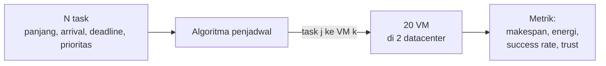

# Penjadwalan Task Cloud dengan Metaheuristik: GSA vs TABWO

Tugas SOKA Semester 5, Kelompok 3. 
Simulator: **CloudSim Plus 8.5.2** (Java 17, Maven).

| Nama | NRP |
|---|---|
| Zein Muhammad Hasan | 5027241035 |
| Ahmad Rafi Fadhillah Dwiputra | 5027241068 |
| Naruna Vicranthyo Putra Gangga | 5027241105 |
| Paundra Pujo Darmawan | 5027241008 |
| Hansen Chang | 5027241028 |

> Pada simulasi project ini, kami menyimulasikan dua algoritma metaheuristik dari paper (GSA dan TABWO) untuk menjadwalkan task di cloud, membandingkannya dengan PSO dan tiga baseline klasik, dan menemukan bahwa **pada anggaran yang kami pakai, baseline klasik (Min-Min, Max-Min, OLB) masih lebih cepat daripada ketiga metaheuristik**.

Daftar isi: [1 Masalah](#1-masalah-yang-diselesaikan) · [2 Sistem](#2-sistem-yang-disimulasikan) · [3 Algoritma](#3-algoritma-dengan-bahasa-sederhana) · [4 Rancangan eksperimen](#4-rancangan-eksperimen) · [5 Hasil](#5-hasil) · [6 Kesimpulan](#6-kesimpulan) · [7 Tanya-jawab](#7-pertanyaan-yang-mungkin-muncul) · [8 Batasan](#8-batasan-yang-harus-disebut-saat-presentasi) · [9 Menjalankan](#9-cara-menjalankan) · [10 Alur presentasi](#10-saran-alur-presentasi)

---

## 1. Masalah yang diselesaikan

Ada **N task** (pekerjaan komputasi) dan **20 mesin virtual (VM)** yang kecepatannya berbeda. Pertanyaannya: **task mana dijalankan di VM mana** supaya:

- semua task selesai secepat mungkin (**makespan** kecil),
- hemat energi,
- sebanyak mungkin task selesai sebelum **deadline** (**success rate** tinggi).

Jumlah kemungkinan jadwalnya `20^N`. Untuk N = 100 saja sudah mustahil dicoba satu per satu. Karena itu dipakai **heuristik** (aturan cepat) atau **metaheuristik** (pencarian cerdas yang terinspirasi alam).

Istilah yang dipakai di seluruh dokumen:

| Istilah | Arti |
| --- | --- |
| **Makespan** | Waktu dari awal sampai task terakhir selesai. Makin kecil makin baik. |
| **FE** (fitness evaluation) | Berapa kali sebuah kandidat jadwal dinilai. Dipakai sebagai "anggaran" pencarian. |
| **Fitness** | Skor sebuah jadwal. Di sini makin kecil makin baik. |
| **Seed** | Angka pembangkit acak. Seed berbeda memberi hasil berbeda, jadi algoritma dijalankan beberapa kali. |
| **Baseline** | Metode sederhana sebagai pembanding. |

---

## 2. Sistem yang disimulasikan



- **Infrastruktur:** 2 datacenter × 5 host. Ada 20 VM dengan total 64 vCPU (kapasitas 92.000 MIPS).

| Tipe VM | Jumlah | vCPU | MIPS per vCPU |
| --- | ---: | ---: | ---: |
| small | 12 | 2 | 1000 |
| medium | 6 | 4 | 1500 |
| large | 2 | 8 | 2000 |

- **Aturan eksekusi:** tiap vCPU menjalankan satu task sampai selesai (tanpa diinterupsi). Task `j` mulai di `max(waktu tiba, waktu slot bebas)` dan butuh `panjang task / MIPS` detik.
- **Data:** 32 instance buatan generator (`tools/generate_workload_meta.py`), panjang task dari tabel GoCJ. Beban sengaja dibuat **2× kapasitas cluster**, jadi sistem selalu kewalahan dan banyak task melewati deadline.

| Wave | Ukuran N |
| --- | --- |
| 1 | 100–1000 (kelipatan 100), 2000, 3000, 4000, 5000, 7500, 10000 |
| 2 | 100, 300, 600, 700, 900, 2000, 3000, 4000 |
| 3 | 200, 300, 600, 800, 1000, 3000, 5000, 10000 |

Alur kerja kode (kenapa cepat): saat mencari, setiap kandidat jadwal dinilai oleh **`ScheduleEvaluator`** (simulasi ringan, tanpa CloudSim). Hanya jadwal terbaik yang akhirnya dijalankan **sekali** di CloudSim untuk mengambil metrik resmi.

---

## 3. Algoritma dengan bahasa sederhana

### 3.1 Cara sebuah kandidat jadwal ditulis

Sebuah kandidat adalah daftar angka desimal, satu per task. Bagian bulatnya adalah nomor VM.

```
x = [3.7, 12.2, 0.4, ...]   ->  task 1 ke VM 3, task 2 ke VM 12, task 3 ke VM 0, ...
```

Ketiga metaheuristik memakai representasi yang sama. Bedanya hanya **cara mereka menggeser angka-angka itu**.

### 3.2 GSA — "planet yang saling tarik"

Setiap kandidat adalah sebuah planet. **Makin bagus jadwalnya, makin berat massanya.** Planet ringan ditarik oleh planet berat, sehingga kandidat buruk bergerak mendekati kandidat bagus.

1. Nilai semua 30 kandidat, hitung massa dari fitness.
2. Hitung gaya tarik dari semua kandidat lain.
3. Gerakkan kandidat sesuai gaya. Kekuatan tarik `G(t)` melemah seiring iterasi.

Fitness dari paper: `f = (γ·makespan + ε) / (δ·total utilisasi + ε)`. Artinya makespan kecil dan utilisasi tinggi menghasilkan skor kecil. Paper tidak menjelaskan beberapa detail, jadi kami berasumsi: `G(t) = 100·exp(−20·t/T)`, kecepatan dibatasi ±10, dan utilisasi dihitung sebagai `beban VM / (kapasitas VM × makespan)`.

### 3.3 TABWO — "laba-laba janda hitam" + kepercayaan (trust)

TABWO adalah Black Widow Optimization (BWO) yang ditambah trust, prioritas, dan biaya listrik. Setiap kandidat adalah seekor laba-laba:

| Tahap | Analogi | Yang dilakukan kode |
| --- | --- | --- |
| **Procreation** | Dua laba-laba kawin | Dua kandidat dicampur: `anak1 = α·ibu + (1−α)·bapak` (α acak per task). |
| **Cannibalism** | Yang lemah dimakan | Dari anak-anak hanya yang terbaik bertahan (peluang bertahan `1−0,44`). Anak terbaik menggantikan induk jika lebih baik ("anak memakan ibu"). Populasi akhirnya dipangkas ke 30 terbaik. |
| **Mutasi adaptif** | Perubahan acak, makin kecil seiring waktu | Sebagian task dipindah VM secara acak. Laju mutasi turun dari 0,02 menuju 0,01 (untuk panjang 100). Operatornya dipilih acak: single point, uniform, SBC. |

Tiga tambahan yang membuatnya "trust-aware":

- **Trust** per VM = `0,5·AV + 0,2·SR + 0,1·TE`. `SR` adalah proporsi task yang selesai sebelum deadline. `AV` selalu 1 (simulator tidak punya VM yang gagal). `TE` mengukur seberapa dekat waktu nyata dengan waktu ideal.
- **Prioritas task:** `prio = (panjang × (4 − prioritas)) / kapasitas VM`. Antrean TABWO menjalankan **nilai prio terbesar lebih dulu**.
- **Biaya listrik:** DC0 berharga 1,0 dan DC1 1,5.

Fitness TABWO (rekonstruksi kami, karena paper tidak memberi rumus): `F = 0,4·makespan + 0,3·biaya energi + 0,3·(1 − trust)`, masing-masing dinormalisasi dengan hasil OLB.

> Catatan implementasi: aturan *sexual cannibalism* dari paper (jantan dimakan betina) hanya diwakili lewat seleksi populasi dan pemilihan "induk terbaik"; kode tidak menghapus induk secara eksplisit.

### 3.4 PSO — "kawanan burung" (pembanding metaheuristik)

Tiap kandidat adalah burung yang mengingat posisi terbaiknya sendiri dan posisi terbaik kawanan, lalu bergerak ke arah keduanya. PSO dibuat karena kedua paper juga membandingkan dengan PSO, dan kerangkanya mirip GSA. Dengan begitu kita bisa tahu apakah GSA/TABWO lebih baik dari metaheuristik standar.

### 3.5 Baseline (pembanding tanpa pencarian)

| Baseline | Ide singkat |
| --- | --- |
| **OLB** | Task satu per satu langsung ke slot yang paling cepat kosong. Sangat naif, jadi dipakai sebagai "lantai" dan sebagai konstanta normalisasi fitness. |
| **Min-Min** | Dari semua task yang belum dijadwalkan, pilih yang bisa selesai paling cepat, taruh di slot terbaiknya, ulangi. **Pembanding utama kami.** |
| **Max-Min** | Seperti Min-Min, tetapi mendahulukan task yang paling lama selesai. |

Kenapa Min-Min jadi pembanding utama: OLB terlalu lemah, sehingga mengalahkannya terlihat bagus secara artifisial. Hanya mengalahkan pembanding yang kuat yang bermakna.

---

## 4. Rancangan eksperimen

| Aspek | Nilai |
| --- | --- |
| Populasi | 30 kandidat |
| Anggaran | **3000 evaluasi fitness** untuk ketiga metaheuristik (supaya adil) |
| Jumlah run | **5 seed** untuk N ≤ 1000 dan **3 seed** untuk N ≥ 2000. Baseline cukup 1 kali karena deterministik. |
| Replay | Setiap hasil akhir dijalankan 1× di CloudSim, metrik diambil dari sana. |
| Lama total | ±19 menit 39 detik untuk seluruh wave dan mode |

**Dua mode**, supaya perbandingan bisa dibaca dengan jelas:

| | **Mode A — setia paper** | **Mode B — kontrol adil** |
| --- | --- | --- |
| GSA | fitness GSA dari paper, antrean FCFS | fitness bersama `0,5·makespan + 0,5·energi` |
| TABWO | fitness TABWO, antrean prioritas, inisialisasi berbias | fitness bersama, antrean FCFS, inisialisasi acak |
| PSO | fitness bersama | fitness bersama (jadi sama di kedua mode) |

Kenapa dua mode? Di Mode A, algoritma yang dibandingkan juga mengoptimalkan **tujuan yang berbeda**, sehingga selisihnya bercampur antara "algoritmanya lebih pintar" dan "tujuannya lain". Mode B menyamakan tujuan, jadi yang tersisa hanya kualitas mekanisme pencarian.

**Validasi evaluator:** `final_fitness` baseline di CSV adalah makespan versi evaluator, dan dapat dibandingkan dengan makespan CloudSim pada baris yang sama:

| Contoh (OLB) | Evaluator | CloudSim | Selisih |
| --- | ---: | ---: | ---: |
| wave 1, N = 100 | 742,29 | 742,60 | 0,04% |
| wave 1, N = 5000 | 7554,29 | 7569,35 | 0,20% |
| wave 1, N = 10000 | 14864,56 | 14888,74 | 0,16% |

Selisihnya jauh di bawah 1%, jadi evaluator layak dipakai sebagai pengganti CloudSim saat pencarian.

---

## 5. Hasil

Sumber: [results/results_meta.csv](results/results_meta.csv) (973 baris data). Tabel berikut dihitung dari **instance wave 1, rata-rata antar seed**. Metaheuristik (GSA, TABWO) ditampilkan di **Mode A**; "TABWO (B)" adalah TABWO di Mode B. PSO sama di kedua mode.

### 5.1 Makespan (detik; makin kecil makin baik)

| N | OLB | Min-Min | Max-Min | GSA | TABWO (A) | PSO | TABWO (B) |
| ---: | ---: | ---: | ---: | ---: | ---: | ---: | ---: |
| 100 | 742,6 | **463,1** | **463,1** | 698,7 | 477,4 | 590,3 | 597,5 |
| 500 | 1441,0 | 1164,8 | **942,9** | 2194,6 | 1495,5 | 1689,7 | 1972,6 |
| 1000 | 1999,5 | **1904,9** | 1911,0 | 3834,3 | 3012,7 | 3603,7 | 3600,0 |
| 2000 | 3518,5 | 3467,0 | **3285,6** | 7538,9 | 5804,2 | 7119,3 | 7166,9 |
| 5000 | 7569,4 | **7522,0** | 7615,5 | 17908,7 | 14449,7 | 17280,7 | 17098,9 |
| 10000 | 14888,7 | 15177,8 | **14887,3** | 35075,0 | 29353,4 | 34379,7 | 33859,5 |

Angka tercetak tebal adalah yang terbaik pada baris itu.

**Gambaran visual** pada N = 10.000 (rasio terhadap Min-Min = 1,00; satu blok = 0,1; makin pendek makin baik):

```
Max-Min    0,98  ██████████
OLB        0,98  ██████████
Min-Min    1,00  ██████████
TABWO (A)  1,93  ███████████████████
TABWO (B)  2,23  ██████████████████████
PSO        2,27  ███████████████████████
GSA        2,31  ███████████████████████
```

Rasio makespan terhadap Min-Min di berbagai ukuran:

| N | GSA | TABWO (A) | PSO |
| ---: | ---: | ---: | ---: |
| 100 | 1,51 | 1,03 | 1,27 |
| 500 | 1,88 | 1,28 | 1,45 |
| 1000 | 2,01 | 1,58 | 1,89 |
| 2000 | 2,17 | 1,67 | 2,05 |
| 5000 | 2,38 | 1,92 | 2,30 |
| 10000 | 2,31 | 1,93 | 2,27 |

### 5.2 Success rate (% task selesai sebelum deadline)

| N | OLB | Min-Min | GSA | TABWO (A) | PSO |
| ---: | ---: | ---: | ---: | ---: | ---: |
| 100 | 100,0 | 100,0 | 91,2 | 98,2 | 90,0 |
| 500 | 87,6 | 71,2 | 58,2 | 34,5 | 59,0 |
| 1000 | 53,7 | 51,0 | 44,8 | 16,4 | 44,6 |
| 2000 | 33,6 | 35,2 | 31,9 | 9,0 | 31,5 |
| 5000 | 13,4 | 15,2 | 19,1 | 4,8 | 19,6 |
| 10000 | 7,4 | 7,3 | 15,4 | 2,5 | 15,9 |

Trust sistem TABWO (A) turun dari sekitar 0,97 (N = 100) ke sekitar 0,63 (N = 10.000).

### 5.3 Energi dan utilisasi CPU pada N = 10.000

| | OLB | Min-Min | GSA | TABWO (A) | PSO | TABWO (B) |
| --- | ---: | ---: | ---: | ---: | ---: | ---: |
| Energi (Wh) | 7145 | 7227 | 12802 | 11132 | 12606 | 12463 |
| Utilisasi CPU (%) | 96,6 | 94,7 | 41,0 | 49,0 | 41,8 | 42,5 |

### 5.4 Waktu komputasi pada N = 10.000

OLB ±3 ms, GSA ±3,5 s, PSO ±4 s, TABWO (B) ±2,7 s, Min-Min ±9,3 s, Max-Min ±10,3 s, **TABWO (A) ±13 s** (lebih lama karena antrean berprioritas harus diurutkan di setiap evaluasi). Seluruhnya masih praktis.

---

## 6. Kesimpulan

1. **Baseline klasik menang di makespan.** Min-Min/Max-Min/OLB paling cepat hampir di semua ukuran. Pada N = 10.000 metaheuristik 1,9–2,3× lebih lambat. (Antar baseline pun tidak ada yang selalu terbaik: Min-Min kalah dari OLB di N = 400 dan N = 10.000.)
2. **Urutan antar metaheuristik pada makespan (Mode A):** TABWO < PSO < GSA. TABWO lebih baik sekitar 11–32% dari GSA dan PSO, tetapi ini perbandingan yang tidak setara karena fungsi tujuan dan antreannya berbeda (lihat butir 4).
3. **Mode B (tujuan disamakan):** selisih antar algoritma mengecil. GSA tetap paling lemah. PSO jelas lebih baik di N = 500 (1690 vs 1973 milik TABWO B). Di ukuran lain PSO dan TABWO (B) berselisih tidak lebih dari ±1,5%, yaitu terlalu kecil untuk disimpulkan tanpa uji statistik.
4. **TABWO (A) menukar SLA dengan makespan.** Makespan turun, tetapi success rate jatuh jauh (N = 1000: 16% vs 45% GSA dan 51% Min-Min) dan response time naik. Penjelasan yang konsisten dengan data: antrean prioritas mendahulukan task panjang berprioritas tinggi, sehingga task pendek menunggu lama dan melewati deadline. Dugaan ini **belum diuji** dengan membalik arah pengurutan.
5. **Success rate harus dibaca hati-hati pada beban 2×.** Pada N besar semua success rate kecil. GSA dan PSO malah lebih tinggi dari baseline (15–16% vs 7,3% pada N = 10.000) walau makespan 2,3× lebih buruk. Kemungkinan karena pola antrean yang berbeda, bukan jadwal yang lebih baik.
6. **Utilisasi CPU metaheuristik hanya 41–49%** dibanding 95% pada baseline: banyak slot dibiarkan menganggur, selaras dengan makespan yang panjang.

**Mengapa metaheuristik kalah? Penjelasan yang paling mungkin:** ruang pencarian besar, sedangkan anggaran kecil. Untuk N = 10.000 ada `20^10000` kemungkinan jadwal, tetapi hanya 3000 kandidat yang dinilai. Pencarian tidak sempat bergerak jauh dari jadwal acak. Min-Min bekerja secara terarah (setiap langkah memilih yang terbaik), sehingga unggul. Ini penjelasan dari pola data, belum dibuktikan dengan percobaan FE yang lebih besar.

---

## 7. Pertanyaan yang mungkin muncul

**Apakah hasil ini bertentangan dengan paper?** Arahnya berbeda: paper menunjukkan algoritma mereka mengalahkan pembanding, sedangkan kami tidak mengalahkan Min-Min. Kami tidak meniru skala, parameter, dan detail paper secara persis (banyak yang tidak dijelaskan di paper dan kami tentukan sendiri). Jadi ini bukan bukti bahwa paper salah, hanya hasil pada setelan kami.

**Mengapa memakai PSO?** Kedua paper membandingkan dengan PSO. Tanpa PSO kita tidak tahu apakah GSA/TABWO bagus dibanding metaheuristik standar. Hasilnya: GSA tidak lebih baik dari PSO, TABWO (A) lebih baik tetapi dengan harga SLA.

**Mengapa Min-Min jadi pembagi persentase, bukan OLB?** OLB lemah, sehingga perbaikan terhadap OLB tampak besar secara artifisial. Min-Min pembanding yang kuat.

**Mengapa tiap algoritma dijalankan 3–5 seed?** Metaheuristik acak. Satu run bisa kebetulan bagus atau buruk. Seed lebih sedikit untuk N besar karena komputasinya lebih mahal.

**Kenapa trust nyaris tidak membedakan?** `AV` selalu 1 karena simulator tidak punya kegagalan VM. Jadi trust praktis ditentukan oleh `SR` dan `TE`.

**Apakah evaluator cepat bisa dipercaya?** Ya untuk makespan: selisihnya kurang dari 0,3% terhadap CloudSim (§4).

---

## 8. Batasan yang harus disebut saat presentasi

- **Anggaran kecil terhadap dimensi besar** (3000 FE, populasi 30, N sampai 10.000). Hasil ini berlaku untuk anggaran tersebut.
- **Tuning pilot tidak dilakukan.** Data pilot (N = 500 dan 2000) sudah dijalankan, tetapi `config/params.properties` tidak diubah. Hasil memakai nilai default. Keputusan yang direncanakan (FE tetap vs `3000+N`, arah `prio_task`, bobot fitness TABWO) belum diuji.
- **Asumsi kami sendiri** karena paper tidak menjelaskan: pemetaan utilisasi GSA, fitness gabungan TABWO, arah antrean prioritas, harga listrik DC, bentuk `G(t)`, dan `L = N` pada mutasi.
- **Statistik lintas wave belum dihitung.** Tabel di §5 hanya wave 1. Wave 2 dan 3 sudah dijalankan dan ada di CSV, tetapi uji Wilcoxon, median, dan agregasi lintas wave belum dijalankan (skrip `tools/aggregate_results.py` sudah ada). Ringkasan di sini bersifat deskriptif, bukan uji signifikansi. Tabel dihitung dari baris mentah CSV, bukan dari keluaran skrip.
- **Baris pilot terduplikasi** di CSV (pilot terjalankan dua kali). Saring `wave ≥ 1` saat menganalisis.
- **Bug yang diketahui:** `Baselines.runFcfsOrHrrn` memakai `id − 1` padahal id dataset mulai dari 0. Fungsi ini tidak dipakai runner, jadi **hasil di atas tidak terpengaruh**, tetapi FCFS/HRRN belum bisa dijadikan referensi sebelum diperbaiki.
- **Uji unit belum dieksekusi dalam sesi penyusunan ini** (berkas uji sudah ada, lihat di bawah). Jalankan `mvn clean test` sebelum presentasi.
- **Kurva konvergensi** tersimpan di `results/convergence/` tetapi belum dianalisis. **Bagian real world (Docker)** belum dikerjakan.

Uji unit yang tersedia (`src/test/java/`):

| Berkas | Memeriksa |
| --- | --- |
| `GsaTest` | fitness GSA (7,586 dan 4,242), massa agen terbaik ≈ 1 dan terburuk ≈ 0 |
| `TabwoTest` | procreation (`v1+v2 = u1+u2`), laju mutasi (0,020 / ≈0,0151 / 0,010), prioritas VM (2,00 / 1,33 / 1,00), prioritas task (0,476), trust (0,71) |
| `ScheduleEvaluatorTest` | selisih makespan evaluator vs CloudSim kurang dari 1% |
| `BaselinesTest`, `PsoTest`, `PlannerTest` | baseline dan PSO menghasilkan pemetaan penuh; contoh HRRN/FCFS; 20 VM teralokasi |

---

## 9. Cara menjalankan

```powershell
mvn clean test                                          # uji unit
mvn compile exec:java "-Dexec.args=--pilot --algos gsa,tabwo,pso"
mvn compile exec:java "-Dexec.args=--mode A,B --algos gsa,tabwo,pso --waves 1,2,3"
python tools/aggregate_results.py --results results/results_meta.csv --outdir results
```

Struktur folder:

```
Metaheuristik/
├── config/params.properties     parameter semua algoritma
├── data/                        wave_manifest.csv, wave1-3/, pilot/
├── tools/                       generate_workload_meta.py, aggregate_results.py
├── src/main/java/               Gsa, Tabwo, Pso, Baselines, ScheduleEvaluator,
│                                PriorityModel, TrustModel, fitness, ExperimentRunner, Main
├── src/test/java/               uji unit
└── results/                     results_meta.csv, convergence/
```

Parameter utama ada di `config/params.properties`: populasi 30, FE 3000, GSA `G0 = 100`, `alpha = 20`, TABWO `PP = 0,6`, `CR = 0,44`, `PM = 0,4`, bobot fitness 0,4/0,3/0,3, PSO `w` 0,9→0,4 dan `c1 = c2 = 1,496`.
