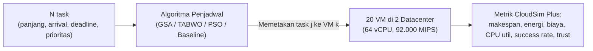
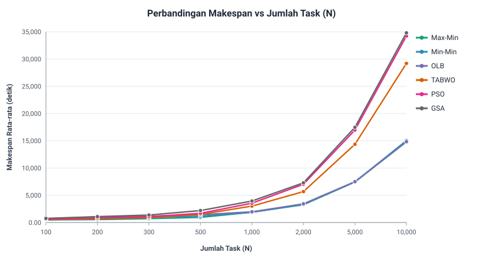
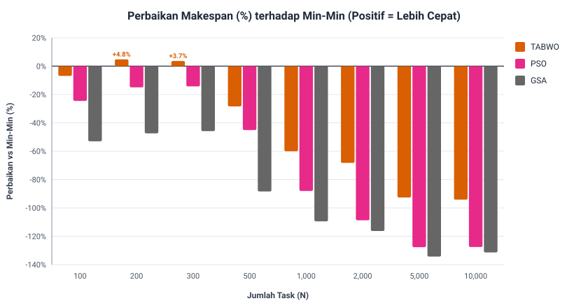
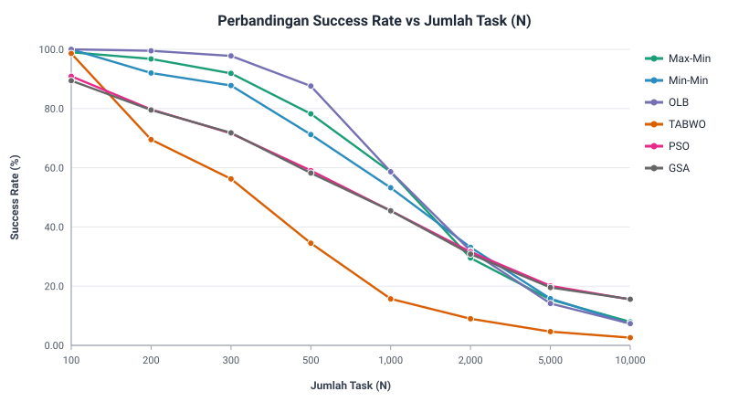
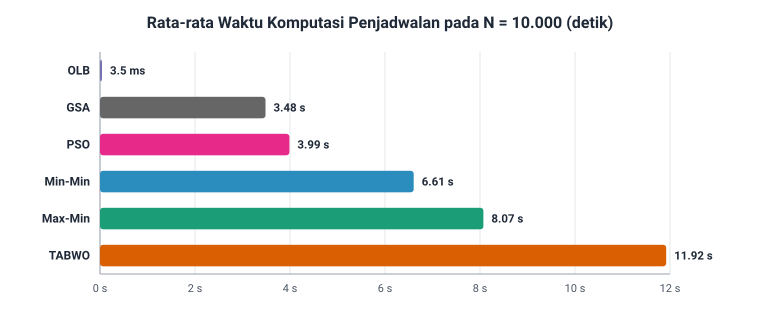
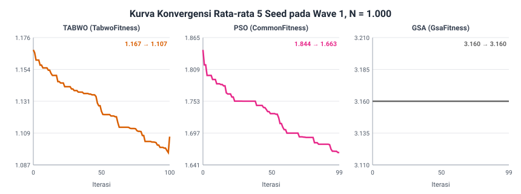

# Penjadwalan Task Cloud dengan Metaheuristik: GSA vs TABWO

Tugas SOKA Semester 5, Kelompok 3.  
Simulator: **CloudSim Plus 8.5.2** (Java 17, Maven).

| Nama | NRP |
|---|---|
| Zein Muhammad Hasan | 5027241035 |
| Ahmad Rafi Fadhillah Dwiputra | 5027241068 |
| Naruna Vicranthyo Putra Gangga | 5027241105 |
| Paundra Pujo Darmawan | 5027241008 |
| Hansen Chang | 5027241028 |

> **Ringkasan Hasil:** Pada proyek ini kami mengimplementasikan dan membandingkan dua algoritma metaheuristik dari paper (**GSA** dan **TABWO**) dengan pembanding metaheuristik standar (**PSO**) serta tiga baseline klasik (**OLB**, **Min-Min**, **Max-Min**) di 32 skenario beban kerja (*504 total eksekusi*). Dengan anggaran **3.000 evaluasi fitness**, **TABWO unggul signifikan atas GSA dan PSO** dalam hal makespan dan energi (`p < 0,0001`), bahkan sempat mengungguli Min-Min pada skala kecil (`N = 200–300`). Namun untuk skala menengah–besar (`N ≥ 500`), **baseline klasik (Min-Min & Max-Min) tetap lebih cepat dan hemat energi** karena ruang pencarian membesar jauh melampaui anggaran 3.000 evaluasi.

Daftar isi:
[1 Masalah](#1-masalah-yang-diselesaikan) · [2 Sistem](#2-sistem-yang-disimulasikan) · [3 Algoritma](#3-algoritma-dengan-bahasa-sederhana) · [4 Rancangan Eksperimen](#4-rancangan-eksperimen) · [5 Hasil](#5-hasil-eksperimen) · [6 Kesimpulan](#6-kesimpulan) · [7 Tanya-Jawab](#7-pertanyaan-yang-mungkin-muncul) · [8 Batasan](#8-batasan-yang-harus-disebut-saat-presentasi) · [9 Menjalankan](#9-cara-menjalankan)

---

## 1. Masalah yang Diselesaikan

Terdapat **N task** komputasi yang datang ke cloud untuk dijalankan pada **20 mesin virtual (VM)** dengan kecepatan berbeda. Tantangannya adalah menentukan **task mana dijalankan di VM mana** agar:

1. **Makespan** sekecil mungkin (semua task selesai secepat mungkin).
2. **Konsumsi energi & biaya listrik** rendah.
3. **Success rate** tinggi (sebanyak mungkin task selesai sebelum *deadline*).

Jumlah kemungkinan pemetaan jadwal adalah $20^N$. Untuk $N = 100$ saja kombinasinya sudah mustahil dicoba satu per satu, sehingga digunakan **heuristik** (aturan konstruktif cepat) dan **metaheuristik** (pencarian cerdas berbasis populasi).

### Istilah Kunci
| Istilah | Arti |
| --- | --- |
| **Makespan** | Total waktu dari simulasi mulai hingga task terakhir selesai (detik). Makin kecil makin baik. |
| **FE** (*Fitness Evaluation*) | Jumlah kandidat jadwal yang dinilai selama pencarian. Dipakai sebagai batas anggaran yang adil antar metaheuristik. |
| **Fitness** | Skor kualitas jadwal yang dioptimalkan oleh algoritma (makin kecil makin baik). |
| **Success Rate** | Persentase task yang selesai sebelum atau tepat pada *deadline*-nya. |
| **Trust** | Skor kepercayaan sistem (0–1) berdasarkan ketersediaan VM, *success rate*, dan ketepatan waktu eksekusi. |
| **Seed** | Angka awal pembangkit bilangan acak. Metaheuristik dijalankan beberapa *seed* agar hasilnya tidak bias satu keberuntungan acak. |
| **Baseline** | Metode klasik deterministik sebagai pembanding. |

---

## 2. Sistem yang Disimulasikan



- **Infrastruktur:** 2 datacenter (DC0 dan DC1) × 5 host = 10 host, menampung **20 VM** dengan total **64 vCPU** (kapasitas total 92.000 MIPS):

| Tipe VM | Jumlah | vCPU per VM | MIPS per vCPU | Total MIPS per VM |
| --- | ---: | ---: | ---: | ---: |
| `small` | 12 | 2 | 1.000 | 2.000 |
| `medium` | 6 | 4 | 1.500 | 6.000 |
| `large` | 2 | 8 | 2.000 | 16.000 |

- **Aturan Eksekusi:** Setiap vCPU mengeksekusi satu task secara *non-preemptive* (sampai selesai tanpa jeda). Task `j` mulai pada `max(waktu tiba, waktu vCPU kosong)` dan membutuhkan durasi `panjang task / MIPS`.
- **Dataset Beban Kerja:** 32 *instance* workload dari generator [generate_workload_meta.py](file:///c:/Kuliah/Sem5/SOKA/Metaheuristik/tools/generate_workload_meta.py) berbasis panjang task GoCJ. Beban sengaja dibuat **2× kapasitas cluster** sehingga sistem mengalami *overload* dan menguji ketahanan penjadwal di bawah tekanan *deadline*.

| Wave | Jumlah Instance | Variasi Ukuran N |
| --- | ---: | --- |
| **Wave 1** | 16 | 100–1.000 (kelipatan 100), 2.000, 3.000, 4.000, 5.000, 7.500, 10.000 |
| **Wave 2** | 8 | 100, 300, 600, 700, 900, 2.000, 3.000, 4.000 |
| **Wave 3** | 8 | 200, 300, 600, 800, 1.000, 3.000, 5.000, 10.000 |

- **Arsitektur Pencarian Cepat:** Selama proses pencarian (3.000 FE), kandidat jadwal dievaluasi menggunakan [ScheduleEvaluator.java](file:///c:/Kuliah/Sem5/SOKA/Metaheuristik/src/main/java/ScheduleEvaluator.java) (model matematis ringan). Hanya **jadwal terbaik akhir** yang di-*replay* 1× ke **CloudSim Plus** untuk mencatat metrik resmi.

---

## 3. Algoritma dengan Bahasa Sederhana

### 3.1 Representasi Kandidat Jadwal
Setiap kandidat jadwal direpresentasikan sebagai vektor bilangan desimal sepanjang `N` (satu nilai per task). Bagian bulatnya (`floor`) menentukan ID VM tujuan (0–19):

```text
x = [3.7, 12.2, 0.4, ...]  ->  task 0 ke VM 3, task 1 ke VM 12, task 2 ke VM 0, ...
```

Ketiga metaheuristik memakai representasi yang sama; perbedaannya ada pada **cara memperbarui posisi vektor**, **fungsi fitness**, dan **aturan antrean**.

### 3.2 GSA (*Gravitational Search Algorithm*) — "Planet yang Saling Tarik"
Setiap kandidat adalah sebuah planet. **Makin bagus fitness jadwalnya, makin berat massanya.** Planet ringan ditarik menuju planet berat:
1. Evaluasi 30 kandidat, lalu hitung massa relatif berdasarkan fitness terbaik dan terburuk.
2. Hitung gaya tarik gravitasi dari seluruh kandidat lain; konstanta gravitasi $G(t) = 100 \cdot \exp(-20 \cdot t / T)$ melemah seiring iterasi.
3. Perbarui kecepatan (dibatasi `±10`) dan posisi vektor.
- **Antrean:** FCFS (*First-Come First-Served*).
- **Fitness ([GsaFitness.java](file:///c:/Kuliah/Sem5/SOKA/Metaheuristik/src/main/java/GsaFitness.java)):** $f = \frac{\gamma \cdot \text{makespan} + \varepsilon}{\delta \cdot \text{total utilisasi} + \varepsilon}$, mendorong makespan kecil dan utilisasi VM tinggi.

### 3.3 TABWO (*Trust-Aware Black Widow Optimization*) — "Laba-laba + Kepercayaan"
TABWO mengembangkan *Black Widow Optimization* dengan kesadaran *trust*, prioritas task, dan biaya listrik:
1. **Inisialisasi Berbias:** Sebagian populasi awal diundi dengan peluang memilih VM sebanding dengan $\text{prio\_VM}_i \times \text{kapasitas}_i$.
2. **Procreation (Kawin):** Pasangan induk menghasilkan keturunan melalui kombinasi linear acak: $\text{anak}_1 = \alpha \cdot \text{ibu} + (1 - \alpha) \cdot \text{bapak}$.
3. **Cannibalism:** Hanya sebagian keturunan terbaik yang bertahan (peluang bertahan `1 − 0,44 = 0,56`), lalu populasi dipangkas kembali ke 30 individu terbaik.
4. **Mutasi Adaptif:** Sebagian elemen task dipindah ke VM lain secara acak dengan laju mutasi yang meluruh dari `0,02` menuju `0,01` (operator acak: *single point*, *uniform*, atau *SBC*).

Fitur tambahan khusus TABWO:
- **Model Trust ([TrustModel.java](file:///c:/Kuliah/Sem5/SOKA/Metaheuristik/src/main/java/TrustModel.java)):** $\text{Trust} = 0{,}5 \cdot AV + 0{,}2 \cdot SR + 0{,}1 \cdot TE$ (dinormalisasi). `AV` bernilai 1 (tanpa kegagalan VM), `SR` mengukur rasio selesai sebelum deadline, dan `TE` mengukur rasio waktu ideal terhadap waktu aktual.
- **Antrean Prioritas ([PriorityModel.java](file:///c:/Kuliah/Sem5/SOKA/Metaheuristik/src/main/java/PriorityModel.java)):** $\text{prio} = \frac{\text{panjang task} \times (4 - \text{prioritas})}{\text{kapasitas VM}}$, diurutkan **menurun** (nilai `prio` terbesar dijalankan lebih dulu).
- **Biaya Listrik:** Tarif DC0 = `1,0` dan DC1 = `1,5`.
- **Fitness ([TabwoFitness.java](file:///c:/Kuliah/Sem5/SOKA/Metaheuristik/src/main/java/TabwoFitness.java)):** $F = 0{,}4 \cdot \frac{M}{M_0} + 0{,}3 \cdot \frac{E_{\text{cost}}}{E_0} + 0{,}3 \cdot (1 - \text{Trust}_{\text{norm}})$, dinormalisasi terhadap hasil OLB ($M_0, E_0$).

### 3.4 PSO (*Particle Swarm Optimization*) — Pembanding Metaheuristik
Setiap kandidat adalah partikel yang bergerak mengikuti posisi terbaik dirinya sendiri (*pBest*) dan posisi terbaik kawanan (*gBest*), dengan inersia $w$ meluruh linear dari `0,9` ke `0,4` dan $c_1 = c_2 = 1{,}496$.
- **Antrean:** FCFS.
- **Fitness ([CommonFitness.java](file:///c:/Kuliah/Sem5/SOKA/Metaheuristik/src/main/java/CommonFitness.java)):** $F = 0{,}5 \cdot \frac{M}{M_0} + 0{,}5 \cdot \frac{E}{E_0}$ (kombinasi makespan dan energi).

### 3.5 Baseline Klasik (Heuristik Tanpa Pencarian)
| Baseline | Cara Kerja Singkat |
| --- | --- |
| **OLB** (*Opportunistic Load Balancing*) | Menempatkan task satu per satu ke VM yang paling cepat kosong tanpa melihat ukuran task. Dipakai sebagai lantai (*floor*) & konstanta normalisasi. |
| **Min-Min** | Dari semua task yang belum dijadwalkan, pilih task dengan waktu selesai tercepat pada VM terbaiknya, jadwalkan, lalu ulangi. **Pembanding utama.** |
| **Max-Min** | Sama seperti Min-Min, tetapi memprioritaskan task dengan waktu selesai paling lama terlebih dahulu. |

---

## 4. Rancangan Eksperimen

| Parameter | Nilai ([params.properties](file:///c:/Kuliah/Sem5/SOKA/Metaheuristik/config/params.properties)) |
| --- | --- |
| Ukuran populasi | 30 kandidat |
| Anggaran evaluasi (FE) | **3.000 evaluasi** per run (sama untuk GSA, TABWO, PSO) |
| Jumlah *seed* | **5 seed** untuk $N \le 1.000$ · **3 seed** untuk $N \ge 2.000$ · **1×** untuk baseline (deterministik) |
| Total eksekusi | **504 run** (96 baseline + 136 GSA + 136 TABWO + 136 PSO) |
| Durasi total run ulang | **10 menit 13 detik** |

**Validasi Evaluator Cepat vs CloudSim Plus (Contoh OLB Wave 1):**
| Ukuran N | Makespan Evaluator (s) | Makespan CloudSim (s) | Selisih |
| ---: | ---: | ---: | ---: |
| 100 | 742,29 | 742,60 | 0,04% |
| 5.000 | 7.554,29 | 7.569,35 | 0,20% |
| 10.000 | 14.864,56 | 14.888,74 | 0,16% |

Selisihnya sangat kecil (**≤ 0,20%**), membuktikan `ScheduleEvaluator` akurat sebagai pengganti CloudSim selama pencarian.

---

## 5. Hasil Eksperimen

Seluruh angka di bawah ini diagregasi dari **504 baris data** pada [results_meta.csv](file:///c:/Kuliah/Sem5/SOKA/Metaheuristik/results/results_meta.csv) (Wave 1, 2, dan 3 digabung, rata-rata antar wave dan *seed*) melalui [aggregate_results.py](file:///c:/Kuliah/Sem5/SOKA/Metaheuristik/tools/aggregate_results.py).

### 5.1 Makespan (detik; makin kecil makin baik)

Data dari [summary_raw_by_size.csv](file:///c:/Kuliah/Sem5/SOKA/Metaheuristik/results/summary_raw_by_size.csv):

| N | OLB | Min-Min | Max-Min | GSA | TABWO | PSO |
| ---: | ---: | ---: | ---: | ---: | ---: | ---: |
| **100** | 681,8 | 494,0 | **485,3** | 756,8 | 529,0 | 614,1 |
| **200** | 996,3 | 732,8 | **544,3** | 1.079,5 | 697,3 | 838,9 |
| **300** | 1.144,3 | 939,4 | **709,6** | 1.369,0 | 904,3 | 1.074,6 |
| **500** | 1.441,0 | 1.164,8 | **942,9** | 2.194,6 | 1.495,5 | 1.689,7 |
| **1.000** | 1.970,1 | **1.884,0** | 1.892,8 | 3.944,8 | 3.014,8 | 3.542,7 |
| **2.000** | 3.424,5 | 3.367,9 | **3.259,4** | 7.285,4 | 5.666,0 | 7.026,8 |
| **5.000** | 7.495,1 | 7.453,6 | **7.442,0** | 17.468,6 | 14.358,7 | 16.972,0 |
| **10.000** | 14.833,6 | 15.039,1 | **14.809,0** | 34.800,8 | 29.197,7 | 34.227,6 |

*(Angka tebal = terbaik pada baris tersebut.)*



**Perbandingan visual rata-rata makespan pada N = 10.000** (rasio terhadap Min-Min = 1,00; makin pendek makin baik):

```text
Max-Min    0,98  ██████████
OLB        0,99  ██████████
Min-Min    1,00  ██████████
TABWO      1,94  ███████████████████
PSO        2,28  ███████████████████████
GSA        2,31  ███████████████████████
```

**Persentase Perbaikan Makespan terhadap Min-Min** ([summary_improvement_minmin.csv](file:///c:/Kuliah/Sem5/SOKA/Metaheuristik/results/summary_improvement_minmin.csv) — nilai positif berarti lebih cepat dari Min-Min, nilai negatif berarti lebih lambat):



| N | GSA | TABWO | PSO |
| ---: | ---: | ---: | ---: |
| **100** | -53,06% | -6,85% | -24,49% |
| **200** | -47,41% | **+4,78%** | -14,94% |
| **300** | -45,84% | **+3,67%** | -14,29% |
| **500** | -88,41% | -28,39% | -45,07% |
| **1.000** | -109,48% | -60,04% | -88,03% |
| **2.000** | -116,28% | -68,26% | -108,74% |
| **5.000** | -134,33% | -92,65% | -127,68% |
| **10.000** | -131,41% | -94,15% | -127,60% |

Terlihat pola yang jelas: pada ukuran kecil (`N = 200` dan `N = 300`), **TABWO masih mampu mengalahkan Min-Min** (+4,78% dan +3,67%) serta mengalahkan OLB (+21,1% pada N=100 hingga +29,9% pada N=200). Namun begitu $N \ge 500$, dimensi ruang pencarian melonjak dan semua metaheuristik tertinggal dari baseline klasik.

---

### 5.2 Success Rate, Response Time, dan Trust



| N | OLB | Min-Min | Max-Min | GSA | TABWO | PSO |
| ---: | ---: | ---: | ---: | ---: | ---: | ---: |
| **100** | **100,0%** | **100,0%** | 99,0% | 89,4% | 98,6% | 90,9% |
| **500** | **87,6%** | 71,2% | 78,2% | 58,2% | 34,5% | 59,0% |
| **1.000** | **58,7%** | 53,3% | 58,6% | 45,5% | 15,7% | 45,5% |
| **2.000** | 32,0% | **33,1%** | 29,5% | 30,8% | 9,0% | 31,6% |
| **5.000** | 14,1% | **15,8%** | 15,5% | 19,5% | 4,6% | 20,1% |
| **10.000** | 7,3% | 7,3% | 7,9% | **15,6%** | 2,6% | 15,5% |

- **Trade-off TABWO (Makespan vs SLA):** Di antara metaheuristik, TABWO memiliki makespan paling rendah, tetapi *success rate*-nya jatuh paling tajam pada beban menengah–besar (hanya **2,6%** pada $N = 10.000$). Penyebabnya terlihat pada rata-rata *response time* di $N = 10.000$: **TABWO 12.560,7 s**, jauh lebih lama dibanding **GSA (8.156,7 s)**, **PSO (8.140,5 s)**, dan **Min-Min (3.487,3 s)**. Antrean prioritas TABWO mendahulukan task panjang berprioritas tinggi, sehingga banyak task pendek menunggu lama dan melewati deadline.
- **Trust Sistem (`trust_norm`):** Untuk TABWO, nilai *trust* turun dari rata-rata **0,9685** ($N = 100$) ke **0,6350** ($N = 10.000$), sejalan dengan turunnya *success rate* pada beban 2× kapasitas.

---

### 5.3 Energi, Biaya Listrik, Utilisasi CPU, dan Keseimbangan Beban (N = 10.000)


| Metrik (rata-rata di N = 10.000) | OLB | Min-Min | Max-Min | GSA | TABWO | PSO |
| --- | ---: | ---: | ---: | ---: | ---: | ---: |
| **Energi (Wh)** | 7.098,9 | 7.158,4 | **7.095,1** | 12.690,3 | 11.058,0 | 12.534,8 |
| **Biaya Listrik (\$)** | 8,874 | 8,953 | **8,868** | 15,862 | 13,767 | 15,667 |
| **Utilisasi CPU (%)** | 95,94% | 94,62% | **96,09%** | 40,89% | 48,76% | 41,58% |
| **Load Imbalance** | **0,031** | 0,086 | 0,038 | 1,320 | 0,957 | 1,303 |

- Baseline klasik menjaga utilisasi CPU **94,6%–96,1%** dengan beban sangat merata (`imbalance < 0,09`), sehingga energi yang terbuang selama VM menganggur (*idle power*) jauh lebih sedikit.
- Sebaliknya, metaheuristik hanya memanfaatkan **40,9%–48,8%** CPU karena banyak slot VM tidak terisi optimal dalam 3.000 evaluasi, menyebabkan makespan memanjang dan energi naik hampir 1,6–1,8× lipat.

---

### 5.4 Uji Signifikansi Statistik (Wilcoxon Signed-Rank Test)

Dari [summary_wilcoxon.csv](file:///c:/Kuliah/Sem5/SOKA/Metaheuristik/results/summary_wilcoxon.csv) lintas seluruh **32 instance** (Wave 1–3):

| Perbandingan | n_instances | Makespan W | Makespan p-value | Energi W | Energi p-value | Kesimpulan |
| --- | ---: | ---: | ---: | ---: | ---: | --- |
| **TABWO vs GSA** | 32 | 0,0 | `< 0,0001` | 0,0 | `< 0,0001` | TABWO unggul sangat signifikan atas GSA |
| **TABWO vs PSO** | 32 | 0,0 | `< 0,0001` | 0,0 | `< 0,0001` | TABWO unggul sangat signifikan atas PSO |
| **GSA vs PSO** | 32 | 0,0 | `< 0,0001` | 0,0 | `< 0,0001` | PSO unggul sangat signifikan atas GSA |
| **TABWO vs MINMIN** | 32 | 19,0 | `< 0,0001` | 13,0 | `< 0,0001` | Min-Min unggul signifikan secara keseluruhan |
| **GSA vs MINMIN** | 32 | 0,0 | `< 0,0001` | 0,0 | `< 0,0001` | Min-Min unggul sangat signifikan atas GSA |

*(Catatan: `p = 0,0` pada file CSV berarti nilai p sangat kecil di bawah pembulatan 4 angka desimal.)*

---

### 5.5 Waktu Komputasi Penjadwalan (N = 10.000)



Rata-rata waktu komputasi algoritma dari [summary_raw_by_size.csv](file:///c:/Kuliah/Sem5/SOKA/Metaheuristik/results/summary_raw_by_size.csv):

| Algoritma | OLB | GSA | PSO | Min-Min | Max-Min | TABWO |
| --- | ---: | ---: | ---: | ---: | ---: | ---: |
| **Waktu (N = 10.000)** | **3,5 ms** | 3,48 s | 3,99 s | 6,61 s | 8,07 s | 11,92 s |

Seluruh algoritma masih sangat praktis untuk dijalankan (< 12 detik pada 10.000 task). TABWO paling lama karena antrean prioritasnya harus mengurutkan task pada setiap evaluasi kandidat.

---

### 5.6 Kurva Konvergensi Metaheuristik (Wave 1, N = 1.000)



Grafik di atas menampilkan rata-rata fitness terbaik per iterasi (dari 5 *seed* pada `Wave 1, N = 1.000`) menggunakan skala fitness masing-masing algoritma:
- **TABWO** menunjukkan penurunan paling konsisten sepanjang 100 iterasi (berkat kombinasi *procreation*, *cannibalism*, dan mutasi adaptif yang menjaga eksplorasi).
- **PSO** turun tajam pada ~35 iterasi awal lalu mulai melandai (*premature convergence*).
- **GSA** cenderung stagnan dari iterasi awal hingga akhir karena besarnya dimensi vektor ($N = 1.000$) membuat gaya tarik gravitasi antar 30 agen terlalu lemah untuk menggeser solusi keluar dari titik awal acak.

---

## 6. Kesimpulan

1. **Urutan performa makespan & energi antar metaheuristik adalah TABWO > PSO > GSA.** TABWO terbukti unggul secara statistik (`p < 0,0001`) atas PSO dan GSA di seluruh 32 skenario, dan GSA konsisten menjadi yang paling lemah.
2. **Baseline klasik (Max-Min & Min-Min) tetap menang di skala menengah–besar ($N \ge 500$).** Pada $N = 10.000$, metaheuristik menghasilkan makespan 1,94–2,31× lebih lama dan konsumsi energi 1,54–1,77× lebih boros dibanding Min-Min/Max-Min.
3. **TABWO mampu bersaing di skala kecil ($N = 200–300$).** Pada ukuran ini TABWO mengalahkan Min-Min sebesar +3,67% hingga +4,78%, menandakan operator BWO + inisialisasi berbias efektif ketika dimensi ruang pencarian masih terjangkau oleh 3.000 FE.
4. **TABWO menukar SLA (*success rate*) demi makespan.** Kebijakan antrean prioritas (`descending`) membuat task berdurasi panjang berjalan lebih dulu sehingga *response time* membengkak dan banyak task pendek melewati *deadline* (*success rate* hanya 2,6% pada $N = 10.000$).
5. **Mengapa metaheuristik kalah pada N besar?** Dengan $20^{10.000}$ kemungkinan jadwal, anggaran **3.000 evaluasi (30 populasi × 100 iterasi)** terlalu kecil untuk konvergen menjauhi titik acak awal, sedangkan heuristik konstruktif (Min-Min/Max-Min) langsung memilih slot terbaik pada setiap langkah.

---

## 7. Pertanyaan yang Mungkin Muncul

- **Apakah hasil ini membuktikan paper GSA/TABWO salah?**  
  Tidak. Paper asli menggunakan skala workload, parameter, dan detail implementasi yang berbeda (sebagian detail tidak dijelaskan di paper sehingga kami tentukan sebagai asumsi). Hasil ini menunjukkan perilaku algoritma pada setelan eksperimen dan batas 3.000 FE kami.
- **Mengapa tetap menyertakan PSO?**  
  Kedua paper membandingkan algoritmanya dengan PSO. Tanpa PSO, kita tidak punya tolok ukur metaheuristik standar untuk menilai apakah GSA dan TABWO lebih baik dari metode *swarm* klasik.
- **Mengapa Min-Min dijadikan pembanding utama, bukan OLB?**  
  OLB terlalu naif (tidak mempertimbangkan panjang task maupun kecepatan VM), sehingga mengalahkan OLB bisa membuat performa terlihat bagus secara artifisial.
- **Mengapa `trust` hampir tidak membedakan antar algoritma?**  
  Dalam rumus $\text{Trust} = 0{,}5 \cdot AV + 0{,}2 \cdot SR + 0{,}1 \cdot TE$, nilai *availability* (`AV`) selalu `1,0` karena simulator tidak memodelkan kegagalan VM, sehingga variasi *trust* murni mengikuti *success rate* dan *time efficiency*.

---

## 8. Batasan yang Harus Disebut Saat Presentasi

- **Anggaran evaluasi tetap (3.000 FE)** untuk semua ukuran $N \in [100, 10.000]$. Penambahan FE adaptif (mis. sebanding $N$) belum diuji.
- **Parameter default (`config/params.properties`)** belum melalui tahap *hyperparameter tuning* otomatis dari hasil pilot.
- **Beberapa asumsi rekonstruksi paper** karena tidak dirinci di paper: bentuk $G(t)$ dan batas kecepatan GSA, rumus bobot fitness komposit TABWO (`0,4 / 0,3 / 0,3`), arah antrean prioritas `descending`, serta tarif listrik DC0/DC1 (`1,0 / 1,5`).
- **Arah antrean prioritas TABWO** (`descending`) belum diuji perbandingannya dengan arah terbalik (`ascending`) untuk memverifikasi perbaikan *success rate*.
- **Bug diketahui pada metode tidak terpakai:** `Baselines.runFcfsOrHrrn` memakai indeks `id - 1` padahal ID task dimulai dari `0`. Metode ini **tidak dipanggil** oleh `ExperimentRunner`, sehingga seluruh hasil eksperimen di atas tidak terpengaruh.
- **Kurva konvergensi** tersimpan di [results/convergence/](file:///c:/Kuliah/Sem5/SOKA/Metaheuristik/results/convergence) untuk analisis lanjutan jika diperlukan.

---

## 9. Cara Menjalankan

```powershell
# 1. Jalankan seluruh unit test (17 test)
mvn clean test

# 2. Jalankan eksperimen penuh (Wave 1, 2, 3)
# Catatan: hapus/pindahkan results/results_meta.csv lama jika ingin mulai bersih
mvn compile exec:java "-Dexec.args=--algos gsa,tabwo,pso --waves 1,2,3"

# 3. Agregasi statistik & uji Wilcoxon
python tools/aggregate_results.py --results results/results_meta.csv --outdir results

# 4. Generate ulang grafik SVG laporan
python tools/plot_charts.py
```

### Struktur Folder Proyek
```text
Metaheuristik/
├── config/params.properties     Konfigurasi populasi, FE, parameter GSA/TABWO/PSO
├── data/wave_manifest.csv       Daftar 32 instance workload (Wave 1–3)
├── tools/
│   ├── generate_workload_meta.py  Generator dataset workload
│   ├── aggregate_results.py       Skrip agregasi statistik & uji Wilcoxon
│   └── plot_charts.py             Generator 6 grafik SVG laporan
├── src/main/java/               Implementasi GSA, TABWO, PSO, Baselines, Evaluator, CloudSim Runner
├── src/test/java/               17 unit test JUnit 5 (GsaTest, TabwoTest, PsoTest, dll.)
└── results/
    ├── results_meta.csv             504 baris hasil mentah run terbaru
    ├── summary_raw_by_size.csv      Rata-rata, std, median per ukuran N
    ├── summary_improvement_*.csv    % perbaikan terhadap Min-Min dan OLB
    ├── summary_wilcoxon.csv         Hasil uji Wilcoxon signed-rank
    ├── charts/                      6 grafik SVG hasil eksperimen & konvergensi
    └── convergence/                 Log fitness terbaik per iterasi
```
